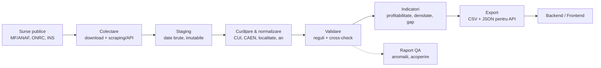

# Radar Economic Galați — Echipa Data Analysis

> Proiect master · FEEA Galați · E-Business
> **Tema 2:** Cele mai profitabile firme din România, ce lipsește în Galați și ce ar avea succes, specificul forței de muncă din Galați. Să verificăm alte orașe.

---

## 1. Despre proiect

Proiectul răspunde la trei întrebări, în ordine:

1. **Național** — Care sunt cele mai profitabile firme din România și în ce domenii (CAEN) activează?
2. **Local** — Ce lipsește în Galați raportat la profilul economic național și ce tip de afacere ar avea succes aici, ținând cont de specificul forței de muncă locale?
3. **Comparativ** — Cum se poziționează Galați față de alte orașe (Iași, Constanța, Brăila, Bacău, Craiova, Cluj, Timișoara etc.)?

Produsul final este o aplicație web (frontend + backend pe API-uri) care expune aceste date într-un mod vizual și explorabil.

## 2. Echipele clasei

| Echipă | Responsabilitate |
|---|---|
| Web design / Frontend | Interfața grafică, vizualizări, UX |
| Backend | Procesare, arhitectură bazată pe API-uri |
| Bază de date (opțional) | Stocare, model de date, interogări |
| **Data Analysis (echipa noastră)** | **Colectare date (scraping, API ANAF etc.), curățare, indicatori, analiză** |
| Test & QA | Validare flux end-to-end, verificarea corectitudinii datelor |
| Marketing | Comunicare, prezentare, promovare |

## 3. Misiunea echipei noastre

Producem **datele** pe care se sprijină tot restul proiectului. Concret:

- Colectăm date din surse publice (ANAF/MF, ONRC, INS, Eurostat).
- Curățăm, normalizăm și validăm datele (CUI, CAEN, localitate, an fiscal).
- Calculăm indicatorii de profitabilitate și de oportunitate locală.
- Livrăm un **set de date stabil, documentat și versionat**, plus materialul analitic pentru raportul final.
- Asigurăm trasabilitatea: fiecare cifră din aplicație trebuie să poată fi urmărită până la sursa primară.

**Nu** ne ocupăm de UI, de infrastructura de hosting sau de design-ul API-ului — dar definim împreună cu backend-ul **contractul de date** (secțiunea 8).

### 3.1 Componența echipei (anonimizat)

5 membri, identificați prin inițiale:

| Membru | Responsabilitate principală |
|---|---|
| **T** | _de completat_ |
| **A** | _de completat_ |
| **E** | _de completat_ |
| **F** | _de completat_ |
| **R** | _de completat_ |

> Identitățile reale nu se trec în repository. În documentele predate, fiecare membru își asumă contribuția prin inițiala din tabel.

## 4. Întrebări de cercetare (ce trebuie să putem răspunde cu date)

| # | Întrebare | Indicator / livrabil |
|---|---|---|
| R1 | Top firme profitabile din RO | Top 100/500 după profit net, cu CAEN, județ, cifră de afaceri, marjă |
| R2 | Ce domenii sunt cele mai profitabile | Profit agregat și marjă mediană pe diviziune CAEN |
| R3 | Ce lipsește în Galați | Densitate firme pe CAEN (la 1.000 locuitori) vs. benchmark național/urban |
| R4 | Ce ar avea succes în Galați | Corelație între cerere locală (populație, salarii, importuri) și ofertă existentă |
| R5 | Specificul forței de muncă | Structura salariaților pe activități, salariu mediu, șomaj, pondere industrie vs. servicii |
| R6 | Comparație orașe | Clasament multi-criteriu pe orașe comparabile ca mărime |

## 5. Surse de date

| Sursă | Ce obținem | Acces | Status |
|---|---|---|---|
| **MF / ANAF — situații financiare anuale** | Bilanț, cont profit și pierdere (CA, profit net, active, datorii, salariați) pe CUI/an | Fișiere bulk (XML/CSV) publicate anual | De verificat |
| **ANAF — date deschise / servicii web** | Date identificare firmă, vector fiscal, TVA, inactivitate | Web services / data.gov.ro | De verificat |
| **ONRC / data.gov.ro** | Date de identificare, cod CAEN, formă juridică, stare | Bulk / portal open data | De verificat |
| **INS TEMPO** | Salariați, salariu mediu brut/net pe județ și activitate, șomaj | Interogare online / export | Confirmat |
| **INS — Recensământ / populație** | Populație stabilă pe localități, structură vârstă | Portal INS | Confirmat |
| **Eurostat / BNR** | Context macro, comparații regionale | API / bulk | Opțional |
| **Site-uri agregatoare (listafirme, termene etc.)** | Cross-check, nu sursă primară | Scraping | Doar validare |

> ⚠️ Reguli: folosim **surse oficiale** ca sursă de adevăr; agregatoarele comerciale doar pentru verificare încrucișată. Respectăm `robots.txt` și termenii de utilizare. Nu republicăm date personale.

## 6. Metodologie

### 6.1 Indicatori de profitabilitate

- `profit_net` = rezultatul net al exercițiului financiar
- `cifra_afaceri` = cifra de afaceri netă
- `marja_net` = `profit_net / cifra_afaceri` (doar dacă `cifra_afaceri > 0`)
- `profit_per_angajat` = `profit_net / nr_salariati`
- `ROA` = `profit_net / total_active`
- `ROE` = `profit_net / capitaluri_proprii`
- `crestere_ca` = variație an la an (unde avem 2 ani)

Filtre obligatorii pentru topuri: `cifra_afaceri > 0`, `nr_salariati > 0` (unde e relevant), excluderea firmelor inactive/dizolvate, excluderea valorilor aberante documentate.

### 6.2 Gap analysis pentru Galați

1. Calculăm **densitatea** firmelor pe fiecare cod CAEN la 1.000 locuitori, pentru Galați.
2. Calculăm aceeași densitate pentru un **benchmark** (media națională urbană + orașe comparabile).
3. `gap = densitate_benchmark − densitate_galati`. Gap mare + profitabilitate mare în domeniu ⇒ **oportunitate**.
4. Ponderăm cu specificul forței de muncă (existența salariaților calificați, salariu mediu, tradiție industrială — Galați = metalurgie, port, construcții navale).

### 6.3 Specificul forței de muncă Galați

- Structura salariaților pe secțiuni CAEN (industrie prelucrătoare, construcții, comerț, servicii).
- Salariu mediu brut/net vs. media națională și pe orașe comparabile.
- Rată șomaj, populație activă, navetism (dacă avem date).
- Concluzie: **ce tip de afacere se potrivește** cu forța de muncă existentă (ex. procesare, logistică/port, servicii pentru industrie, IT unde există masă critică).

## 7. Pipeline de date



Principii:
- **Datele brute nu se modifică niciodată** (folder `date/raw/`, read-only, cu data descărcării).
- Orice transformare e **scriptată** (reproductibilă), nu manuală în Excel.
- Fiecare fișier livrat are **sursă + dată + hash/versiune**.

## 8. Contract de date cu backend-ul

Format propus (de agreat cu echipa de backend):

```json
{
  "firma": {
    "cui": 12345678,
    "denumire": "EXEMPLU S.A.",
    "cod_caen": "2410",
    "caen_descriere": "Producția de metale feroase",
    "judet": "Galați",
    "localitate": "Galați",
    "an_fiscal": 2024,
    "cifra_afaceri": 0,
    "profit_net": 0,
    "marja_net": 0.0,
    "nr_salariati": 0,
    "profit_per_angajat": 0.0,
    "stare": "activa"
  },
  "indicator_local": {
    "localitate": "Galați",
    "cod_caen": "2410",
    "firme_la_1000_locuitori": 0.0,
    "benchmark": 0.0,
    "gap": 0.0,
    "scor_oportunitate": 0.0
  }
}
```

Reguli pentru API:
- chei în `snake_case`, numerice ca `number` (nu string), `null` pentru lipsă.
- `cui` este **cheia primară** stabilă.
- sumele în **RON**, fără separatori, fără rotunjiri ascunse.
- un endpoint = un tabel normalizat; agregările se fac în backend.

## 9. Structura folderului

```
Proiect/
├── README.md
├── date/
│   ├── raw/          # descărcări brute, imutabile (git-ignored dacă e mare)
│   ├── staging/      # date intermediare
│   └── output/       # livrabile finale: CSV + JSON pentru API
├── scripts/          # colectare, curățare, indicatori (Python)
├── notebooks/        # explorare, grafice pentru raport
├── documentatie/     # dicționar de date, surse, metodologie
└── raport/           # materialul scris (capitole, grafice finale)
```

## 10. Convenții

- **Encoding** UTF-8, diacritice românești corecte.
- **CUI**: întreg, fără `RO`, fără spații; validare cu cifra de control.
- **CAEN**: păstrăm codul din sursă (Rev.2/Rev.3) + un câmp `caen_versiune`; mapare explicită între revizii, nu presupunem echivalență.
- **Localitate/județ**: normalizate la nomenclatorul INS (ex. `GALAȚI` → `Galați`).
- **An fiscal**: 4 cifre; documentăm dacă anul e cel de raportare sau de exercițiu.
- **Nume fișiere**: `sursa__continut__an__versiune.csv` (ex. `mfinante__bilant__2023__v1.csv`).
- **Git**: commits mici, mesaje în română, fără date brute mari (>50 MB → releases/cloud intern).
- **Nu** urcăm date cu caracter personal sau credențiale.

## 11. Plan de lucru

| Etapa | Ce facem | Livrabil |
|---|---|---|
| E1 | Validăm sursele, descărcăm primele fișiere, definim schema | `documentatie/surse.md`, mostre raw |
| E2 | Curățare + normalizare CUI/CAEN/localitate | `date/staging/` + raport de acoperire |
| E3 | Indicatori profitabilitate + topuri | `date/output/top_firme.csv` |
| E4 | Date INS (muncă, populație) + benchmark orașe | `date/output/indicatori_locali.csv` |
| E5 | Gap analysis + scor de oportunitate | `date/output/gap_galati.json` |
| E6 | Grafice + text pentru raport, predare către backend/QA | `raport/`, contract de date final |

## 12. Riscuri și mitigare

| Risc | Impact | Mitigare |
|---|---|---|
| Fișierele ANAF/MF au formate instabile de la an la an | Colectare întârziată | Parser versionat per an, testat pe 2 ani |
| CAEN Rev.2 vs Rev.3 | Comparații greșite | Tabel de mapare explicit + câmp de versiune |
| Date lipsă (firme fără bilanț) | Topuri distorsionate | Raport de acoperire, marcare `null`, fără imputare artificială |
| Suprapunere cu backend pe „cine calculează agregările” | Confuzie | Contract de date (secțiunea 8) + un singur loc de calcul |
| Scraping blocat / rate-limit | Colectare incompletă | Preferăm bulk/API oficial, cache local, backoff |

## 13. Definition of Done (pentru echipa noastră)

- [ ] Sursele sunt documentate cu URL, licență, dată descărcare.
- [ ] Scripturile rulează cap-coadă cu o singură comandă, pe un folder curat.
- [ ] Fișierele din `date/output/` respectă contractul de date.
- [ ] Există dicționar de date (fiecare coloană explicată).
- [ ] QA poate verifica 5 firme de top manual, din sursa primară.
- [ ] Raportul de acoperire arată câte firme au date complete pe fiecare an.
- [ ] Graficele din raport se regenerează din `date/output/`.

---

## Contact & colaborare

- **Echipa:** Data Analysis — T, A, E, F, R (5 membri)
- **Interfață cu backend:** contract de date (secțiunea 8) — orice schimbare se anunță în avans.
- **Interfață cu QA:** livrăm `date/output/` + raport de acoperire + dicționar de date.
- **Interfață cu Marketing:** livrăm 5–10 concluzii-cheie cu cifre verificabile, nu interpretări.
